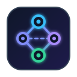
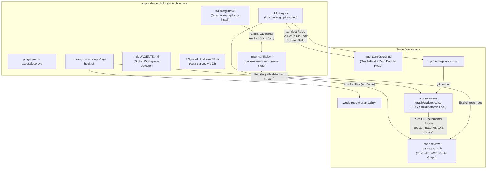

# `agy-code-graph` — Native Antigravity Code Knowledge Graph Plugin

<p align="left">
  
</p>

[](LICENSE)
[](https://github.com/JsonLee12138/agy-code-graph)
[](https://modelcontextprotocol.io)
[](https://python.org)
[](https://tree-sitter.github.io)
[](https://github.com/tirth8205/code-review-graph)

> [!NOTE]
> **Languages**: **English** | [简体中文](README.zh.md)

**`agy-code-graph`** is a native code knowledge graph plugin engineered for **Google Antigravity (AGY CLI / IDE / 2.0 / Python SDK)**, powered by [tirth8205/code-review-graph](https://github.com/tirth8205/code-review-graph) (Tree-sitter AST parsing + embedded SQLite graph database).

Traditional AI coding assistants waste significant context window tokens by performing brute-force greps or reading whole files blindly. `agy-code-graph` enforces a **Graph-First Retrieval** and **Zero Double-Read** protocol: the AI agent queries the AST graph first to inspect call hierarchies, impact blast radius, and execution flows, reading only the exact line ranges when necessary. This drastically speeds up reasoning while preventing token exhaustion and hallucinations.

---

## Key Highlights

### 1. 100% Unfiltered MCP Tool Surface + Zero `cwd` Drift
- **Zero Tool Castration or Proxy Overhead**: Directly mounts `code-review-graph serve` via `stdio`, exposing all 22+ upstream MCP tools and prompts (`get_minimal_context_tool`, `get_impact_radius_tool`, `semantic_search_nodes_tool`, `query_graph_tool`, `get_review_context_tool`, `detect_changes_tool`, `get_flow_tool`, `get_affected_flows_tool`, `get_architecture_overview_tool`, `list_communities_tool`, `refactor_tool`, `apply_refactor_tool`, `build_or_update_graph_tool`, etc.).
- **Zero `cwd` Drift**: Plugin and workspace rules strictly mandate passing explicit `repo_root="<active_workspace_root>"` on every call, eliminating working directory confusion across multi-root or subfolder sessions.

### 2. Decoupled Two-Tier Setup Skills
- **`/agy-code-graph:crg-install` (Global CLI Installer)**: Detects runtime environments and installs or upgrades the `code-review-graph` CLI globally via `uv tool`, `pipx`, or `pip` without starting background daemons.
- **`/agy-code-graph:crg-init` (Workspace Bootstrapper)**: Injects the graph-first workspace rule (`.agents/rules/crg.md`), configures `.gitignore`, installs an idempotent atomic-locked Git `post-commit` hook, and builds the initial `graph.db`.

### 3. Pure-CLI Lifecycle Sync (Deterministic, Zero Latency)
- **`PostToolUse` (`mark-dirty`)**: Active only in initialized workspaces. Filters out external `<ArtifactDir>` writes and marks `.code-review-graph/.dirty` in `~1ms`.
- **`Stop` (`sync-on-stop`)**: Fires when the agent turns `fullyIdle: true`. Uses a POSIX atomic directory lock (`mkdir .code-review-graph/update.lock.d` with 10-minute stale lock auto-recovery) and completely detaches standard I/O streams (`>/dev/null 2>&1 </dev/null &`). Runs incremental updates (`code-review-graph update --base HEAD` and `update`) in the background **without blocking Antigravity's response stream**.
- **Git `post-commit` Hook**: Reuses the same atomic directory lock to incrementally re-index committed changes in the background upon `git commit`.

### 4. 7 Upstream Workflow Skills + Automated CI Sync
- Bundles all 7 official upstream workflow skills from `tirth8205/code-review-graph@staging`.
- A single `.github/workflows/ci.yml` validates and syncs upstream skills on `push` to `main` via `chore(skills): sync upstream skills [skip ci]`, avoiding noisy PR generation.

---

## Architecture



---

## Quick Start

### 1. Install Plugin

#### Option A: Install via Antigravity CLI (Recommended)

Install directly from the GitHub repository URL:

```bash
agy plugin install https://github.com/JsonLee12138/agy-code-graph.git
```

#### Option B: Clone into Plugins Directory

Clone the repository directly into your Antigravity global plugins directory:

```bash
git clone https://github.com/JsonLee12138/agy-code-graph.git ~/.gemini/config/plugins/agy-code-graph
```

#### Verify Installation

Verify the plugin is active and adheres to the strict Antigravity schema (0 errors, 0 warnings):

```bash
# Verify plugin is registered
agy plugin list

# Validate plugin schema in strict mode
agy plugin validate ~/.gemini/config/plugins/agy-code-graph --strict
```

### 2. Install `code-review-graph` CLI Globally

Inside the Antigravity chat prompt:

```text
/agy-code-graph:crg-install
```

Or execute directly in your shell:

```bash
# Verify environment readiness
bash scripts/install-crg.sh --check

# Install or upgrade globally
bash scripts/install-crg.sh
```

### 3. Initialize Code Graph in Your Project

Inside your project's Antigravity session:

```text
/agy-code-graph:crg-init
```

Or run the initialization script directly:

```bash
# Check repository status (returns JSON)
bash scripts/init-crg.sh --check /path/to/your-repo

# Bootstrap: inject rules, install post-commit hook & build initial graph
bash scripts/init-crg.sh /path/to/your-repo

# Optional: merge local lifecycle hooks into .agents/hooks.json
bash scripts/init-crg.sh /path/to/your-repo --with-local-hooks
```

---

## Bundled Skills Reference (9 Skills)

| Slash Command / Skill | Origin | Purpose & Best Use Cases |
| :--- | :--- | :--- |
| `/agy-code-graph:crg-install` | Plugin Native | Detects and globally installs or upgrades the `code-review-graph` CLI via `uv tool`, `pipx`, or `pip`. |
| `/agy-code-graph:crg-init` | Plugin Native | Injects `.agents/rules/crg.md`, `.gitignore`, atomic `post-commit` hook, and builds the initial `graph.db`. |
| `/agy-code-graph:build-graph` | Upstream Sync | Manually builds or updates the Tree-sitter AST knowledge graph for the active repository. |
| `/agy-code-graph:explore-codebase` | Upstream Sync | Explores an unfamiliar repository via high-level architecture overview, code communities, and execution flows. |
| `/agy-code-graph:review-changes` | Upstream Sync | Reviews uncommitted changes with blast-radius call-chain analysis and test gap detection. |
| `/agy-code-graph:review-delta` | Upstream Sync | Reviews incremental code diffs since the last graph update for fast, low-token reviews. |
| `/agy-code-graph:review-pr` | Upstream Sync | Performs deep structural review and blast-radius analysis across branch diffs or pull requests. |
| `/agy-code-graph:refactor-safely` | Upstream Sync | Uses `refactor_tool` and `get_impact_radius_tool` to preview and safely execute cross-file renames and refactoring. |
| `/agy-code-graph:debug-issue` | Upstream Sync | Diagnoses root causes along AST call hierarchies, dependency edges, and affected execution flows. |

---

## Key MCP Tools Reference

The plugin passes through all tools from `code-review-graph serve`:

| MCP Tool | Description |
| :--- | :--- |
| `get_minimal_context_tool` | Extracts concise structural context (signature, callers, callees, dependencies) for a given symbol. |
| `get_impact_radius_tool` | Calculates the blast radius of changes to a function, class, or file (direct callers, indirect consumers, tests). |
| `get_review_context_tool` | Generates structured review context including impacted entities, modified flows, and risk indicators. |
| `semantic_search_nodes_tool` | Performs semantic search across graph nodes and symbols, with optional source snippet extraction. |
| `query_graph_tool` | Queries the raw AST graph (filter by name, path, entity type, or edge relationships). |
| `detect_changes_tool` | Detects workspace file modifications relative to the current indexed graph. |
| `get_flow_tool` / `get_affected_flows_tool` | Traces critical execution flows and identifies flows affected by proposed edits. |
| `get_architecture_overview_tool` | Returns high-level architectural decomposition and subsystem summaries. |
| `list_communities_tool` | Displays detected code communities / modules using graph partitioning algorithms. |
| `refactor_tool` / `apply_refactor_tool` | Previews and applies atomic cross-file symbol refactoring and renaming. |
| `build_or_update_graph_tool` | Triggers a full build or incremental update of the repository graph. |

> [!TIP]
> Always pass `repo_root="<absolute_path_to_workspace>"` when invoking MCP tools via agents or SDK scripts.

---

## Google Antigravity Python SDK Integration

If building a custom agent with the `google-antigravity` Python SDK, mount the plugin's MCP server and lifecycle hooks directly:

```python
import subprocess
from pathlib import Path
from antigravity import Agent, Hooks, McpStdioServer

PLUGIN_ROOT = Path("~/.gemini/config/plugins/agy-code-graph").expanduser()

# 1. Mount the Code Review Graph MCP stdio server
crg_mcp = McpStdioServer(
    name="agy-code-graph",
    command="code-review-graph",
    args=["serve"],
)

# 2. Register non-blocking lifecycle hooks
hooks = Hooks()

@hooks.post_tool_call
async def mark_graph_dirty(ctx):
    """Mark workspace dirty (~1ms) on write operations"""
    if ctx.tool_name in {"edit_file", "write_file", "create_file", "delete_file"}:
        subprocess.run(
            ["sh", str(PLUGIN_ROOT / "scripts/crg-hook.sh"), "mark-dirty"],
            input=ctx.to_json().encode("utf-8"),
            check=False,
        )

@hooks.stop
async def sync_graph_on_stop(ctx):
    """Trigger detached non-blocking background incremental sync when fully idle"""
    subprocess.run(
        ["sh", str(PLUGIN_ROOT / "scripts/crg-hook.sh"), "sync-on-stop"],
        input=ctx.to_json().encode("utf-8"),
        check=False,
    )

# 3. Instantiate Agent
agent = Agent(
    model="gemini-2.5-pro",
    mcp_servers=[crg_mcp],
    hooks=hooks,
)
```

---

## Local Quality Gate & Integration Tests (Software 1.0 Gate)

Run the comprehensive quality gate script locally before shipping:

```bash
bash scripts/gate-check.sh
```

Verification pipeline:
1. **Gate 0/5**: Disk SSoT contracts verification (`.artifacts/SPEC.md`, `CONSTRAINTS.md`, `PLAN.md`).
2. **Gate 1/5**: Shell syntax validation for all POSIX `sh` and `bash` scripts (`sh -n` / `bash -n`).
3. **Gate 2/5**: Antigravity plugin schema strict validation (`agy plugin validate --strict`).
4. **Gate 3/5**: Upstream skills verification against official references.
5. **Gate 4/5**: 5 deterministic end-to-end integration tests (manifest schema, unfiltered MCP surface, decoupled install/init, boundary guards, and non-blocking stream detachment).
6. **Gate 5/5**: Secret scanning and absolute path leakage checks.

---

## License & Acknowledgements

- Licensed under the [MIT License](LICENSE).
- Core knowledge graph engine by [tirth8205/code-review-graph](https://github.com/tirth8205/code-review-graph).
- Built for the [Google Antigravity](https://github.com/JsonLee12138/agy-code-graph) agentic coding ecosystem.
