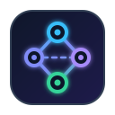
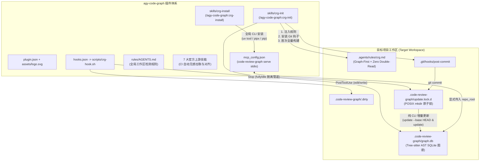

# `agy-code-graph` — Google Antigravity 原生代码知识图谱插件

<p align="left">
  
</p>

[](LICENSE)
[](https://github.com/JsonLee12138/agy-code-graph)
[](https://modelcontextprotocol.io)
[](https://python.org)
[](https://tree-sitter.github.io)
[](https://github.com/tirth8205/code-review-graph)

> [!NOTE]
> **语言 / Languages**: **简体中文** | [English](README.md)

**`agy-code-graph`** 是专为 **Google Antigravity (AGY CLI / IDE / 2.0 / Python SDK)** 打造的高性能原生代码知识图谱插件。基于 [tirth8205/code-review-graph](https://github.com/tirth8205/code-review-graph)（Tree-sitter AST 语法树解析器 + SQLite 嵌入式图数据库）构建，为 AI 编程 Agent 提供精准、低成本的结构化代码感知能力。

传统 AI 编程助手通常依赖全盘扫描（Grep/Find）或盲目阅读整文件，极易消耗宝贵的上下文窗口（Context Window）并造成“幻觉”。`agy-code-graph` 践行 **Graph-First（图谱优先检索）** 与 **Zero Double-Read（零冗余复读）** 原则：让 Agent 优先向代码图谱查询精确的方法调用链路、影响半径（Blast Radius）与架构流（Flows），只在需要时精确按行切片读取代码，显著提升推理速度并大幅节省 Token。

---

## 核心特性 (Key Highlights)

### 1. 100% 完整开放上游 MCP 工具集 + 彻底杜绝 `cwd` 漂移
- **零阉割、零代理**：通过 `stdio` 方式直接挂载 `code-review-graph serve`，完整开放上游全部 22+ 个 MCP 工具与 Prompts（涵盖 `get_minimal_context_tool`、`get_impact_radius_tool`、`semantic_search_nodes_tool`、`query_graph_tool`、`get_review_context_tool`、`detect_changes_tool`、`get_flow_tool`、`get_affected_flows_tool`、`get_architecture_overview_tool`、`list_communities_tool`、`refactor_tool`、`apply_refactor_tool`、`build_or_update_graph_tool` 等）。
- **零 `cwd` 漂移**：通过全局规则与工作区规则强制要求每次调用显式传入 `repo_root="<active_workspace_root>"`，彻底解决多项目、多工作区下全局 MCP 进程的工作目录混乱问题。

### 2. 职责清晰解耦的双安装与初始化技能
- **`/agy-code-graph:crg-install`（全局 CLI 安装器）**：仅专注检测环境并在全局通过 `uv tool` / `pipx` / `pip` 安装或升级 `code-review-graph` CLI（读取官方 GitHub 仓库说明，不常驻后台 Daemon）。
- **`/agy-code-graph:crg-init`（项目工作区初始化器）**：专注为目标 Git 仓库注入图谱优先规则（`.agents/rules/crg.md`）、配置 `.gitignore`、安装带原子文件锁的幂等 Git `post-commit` 钩子，并执行首次 `code-review-graph build`。

### 3. 100% 纯 CLI 驱动的生命周期增量同步（极速、无阻塞）
- **`PostToolUse` (`mark-dirty`)**：仅在已初始化的工作区生效；自动忽略工作区外的临时目录与 `<ArtifactDir>`，耗时仅 `~1ms` 即可在 `.code-review-graph/.dirty` 标记脏状态。
- **`Stop` (`sync-on-stop`)**：当 Agent 结束本轮回答且进入 `fullyIdle` 状态时触发。通过 POSIX `mkdir .code-review-graph/update.lock.d` 原子目录锁（附带 10 分钟僵尸锁自愈机制）与 `>/dev/null 2>&1 </dev/null &` 彻底脱离标准流管道，在后台运行纯 CLI 命令（`code-review-graph update --base HEAD` 与 `code-review-graph update`），**绝对不阻塞 Antigravity 的 Stop 响应流**。
- **Git `post-commit`**：开发者每次在终端或 IDE 提交代码时，钩子同样复用原子锁在后台极速完成图谱增量更新。

### 4. 内置 7 大官方工作流 Skills + 单一 CI 无感自动更新
- 原汁原味内置 `tirth8205/code-review-graph@staging` 官方全部 7 个核心技能。
- 单一 `.github/workflows/ci.yml` 在代码推送到 `main` 分支时自动校验并拉取上游最新技能，通过 `chore(skills): sync upstream skills [skip ci]` 优雅合入，无冗余 PR 噪音。

---

## 架构概览 (Architecture)



---

## 快速上手 (Quick Start)

### 1. 安装插件

#### 方式一：通过 Antigravity CLI 远程安装（推荐）

直接通过 GitHub 仓库地址使用 `agy` 命令行安装：

```bash
agy plugin install https://github.com/JsonLee12138/agy-code-graph.git
```

#### 方式二：手动克隆至插件目录

直接克隆至 Antigravity 全局插件配置目录：

```bash
git clone https://github.com/JsonLee12138/agy-code-graph.git ~/.gemini/config/plugins/agy-code-graph
```

#### 验证安装状态

```bash
# 查看已安装插件列表
agy plugin list

# 严格模式校验插件规范（0 报错、0 警告）
agy plugin validate ~/.gemini/config/plugins/agy-code-graph --strict
```

### 2. 全局安装 `code-review-graph` CLI

在 Google Antigravity 对话框中键入：

```text
/agy-code-graph:crg-install
```

也可以直接在终端执行脚本：

```bash
# 检查当前环境状态
bash scripts/install-crg.sh --check

# 全局安装或升级 CLI
bash scripts/install-crg.sh
```

### 3. 在目标项目中初始化代码知识图谱

在目标项目的 Antigravity 对话中输入：

```text
/agy-code-graph:crg-init
```

或在终端中直接运行：

```bash
# 检查目标仓库状态
bash scripts/init-crg.sh --check /path/to/your-repo

# 一键初始化：注入规则 + 安装 post-commit 钩子 + 构建初次图谱
bash scripts/init-crg.sh /path/to/your-repo

# 可选：同时将项目本地生命周期钩子合并注入至 .agents/hooks.json
bash scripts/init-crg.sh /path/to/your-repo --with-local-hooks
```

---

## 内置技能列表 (9 Bundled Skills)

| 技能命令 (Slash / Skill) | 来源类型 | 核心功能与使用时机 |
| :--- | :--- | :--- |
| `/agy-code-graph:crg-install` | 插件原生 | 自动检测并使用 `uv tool` / `pipx` / `pip` 全局安装或升级 `code-review-graph` CLI。 |
| `/agy-code-graph:crg-init` | 插件原生 | 为当前项目注入 `.agents/rules/crg.md`、配置 `.gitignore`、配置原子锁 `post-commit` 钩子并构建首个 `graph.db`。 |
| `/agy-code-graph:build-graph` | 上游官方同步 | 手动构建或增量更新当前代码库的 Tree-sitter AST 知识图谱。 |
| `/agy-code-graph:explore-codebase` | 上游官方同步 | 基于图谱整体架构全景、业务社区（Communities）与核心调用链路（Flows）高效探索陌生项目。 |
| `/agy-code-graph:review-changes` | 上游官方同步 | 针对工作区当前未提交的改动执行结构化审查，分析爆炸半径与测试覆盖率缺口。 |
| `/agy-code-graph:review-delta` | 上游官方同步 | 仅审查自上一次图谱记录以来的增量代码差异，实现极速且低 Token 消耗的审查。 |
| `/agy-code-graph:review-pr` | 上游官方同步 | 针对 Pull Request 或指定分支进行全局架构影响面分析与全面代码审查。 |
| `/agy-code-graph:refactor-safely` | 上游官方同步 | 结合 `refactor_tool` 与 `get_impact_radius_tool` 安全预览、分析并执行跨文件重命名与重构。 |
| `/agy-code-graph:debug-issue` | 上游官方同步 | 顺着 AST 调用拓扑链、依赖关系边与执行流快速定位 Bug 的根本诱因。 |

---

## 核心 MCP 工具速查 (Key MCP Tools)

插件通过 `mcp_config.json` 完整透传 `code-review-graph serve` 提供的全部工具：

| 工具名称 | 核心能力 |
| :--- | :--- |
| `get_minimal_context_tool` | 输入目标函数或类名，提取精简上下文（声明、关键依赖、调用方、被调用方）。 |
| `get_impact_radius_tool` | 计算特定符号或文件修改后的爆炸影响半径（直接调用、间接依赖、受影响测试）。 |
| `get_review_context_tool` | 生成用于代码审查的结构化上下文（涉及实体、调用流变更、风险指数）。 |
| `semantic_search_nodes_tool`| 语义检索代码图谱中的节点与符号，支持带代码源码片段输出。 |
| `query_graph_tool` | 执行底层图谱查询（按名称、文件路径、类型、关系边筛选）。 |
| `detect_changes_tool` | 检查工作区代码相对于已建图谱的增量变化。 |
| `get_flow_tool` / `get_affected_flows_tool` | 查询系统核心执行流，以及某项变更波及到的业务流链路。 |
| `get_architecture_overview_tool` | 获取代码库的高层架构概览与子系统划分。 |
| `list_communities_tool` | 基于图算法（Louvain / 文件聚类）展示代码社区模块划分。 |
| `refactor_tool` / `apply_refactor_tool` | 预览并原子应用跨文件的重构与符号重命名。 |
| `build_or_update_graph_tool` | 触发图谱全量构建或增量更新。 |

> [!TIP]
> 每次通过 Agent 或 SDK 调用上述工具时，均需携带 `repo_root="<当前工作区根目录绝对路径>"`。

---

## Google Antigravity Python SDK 集成示例

如果你正在基于 `google-antigravity` Python SDK 开发定制化 Agent，可直接挂载本插件的配置与生命周期脚本：

```python
import subprocess
from pathlib import Path
from antigravity import Agent, Hooks, McpStdioServer

PLUGIN_ROOT = Path("~/.gemini/config/plugins/agy-code-graph").expanduser()

# 1. 注册完整 Code Review Graph MCP stdio 服务
crg_mcp = McpStdioServer(
    name="agy-code-graph",
    command="code-review-graph",
    args=["serve"],
)

# 2. 挂载高性能生命周期 Hooks
hooks = Hooks()

@hooks.post_tool_call
async def mark_graph_dirty(ctx):
    """当 Agent 执行文件写操作时，快速标记脏状态 (~1ms)"""
    if ctx.tool_name in {"edit_file", "write_file", "create_file", "delete_file"}:
        subprocess.run(
            ["sh", str(PLUGIN_ROOT / "scripts/crg-hook.sh"), "mark-dirty"],
            input=ctx.to_json().encode("utf-8"),
            check=False,
        )

@hooks.stop
async def sync_graph_on_stop(ctx):
    """当 Agent 完成回答且 fullyIdle 时，在后台非阻塞执行增量同步"""
    subprocess.run(
        ["sh", str(PLUGIN_ROOT / "scripts/crg-hook.sh"), "sync-on-stop"],
        input=ctx.to_json().encode("utf-8"),
        check=False,
    )

# 3. 实例化 Agent
agent = Agent(
    model="gemini-2.5-pro",
    mcp_servers=[crg_mcp],
    hooks=hooks,
)
```

---

## 本地质量门禁与端到端测试 (Software 1.0 Gate)

本项目具备严密的自动化质量保障体系。可在根目录下运行一键门禁脚本：

```bash
bash scripts/gate-check.sh
```

门禁执行内容：
1. **Gate 0/5**：校验 Disk SSoT 契约文件完整性（`.artifacts/SPEC.md`、`CONSTRAINTS.md`、`PLAN.md`）。
2. **Gate 1/5**：校验所有 Shell 脚本（POSIX `sh` 与 `bash`）语法严谨性（`sh -n` / `bash -n`）。
3. **Gate 2/5**：执行 Antigravity 插件 Schema 严格验证（`agy plugin validate --strict`）。
4. **Gate 3/5**：校验 7 大上游技能与官方源码的一致性与完整性。
5. **Gate 4/5**：运行 5 组确定性端到端集成测试（覆盖清单规范、MCP 开放度、初始化幂等性、边界守卫、后台非阻塞管道断开验证）。
6. **Gate 5/5**：敏感信息与硬编码绝对路径安全扫描。

---

## 开源协议与鸣谢 (License & Acknowledgements)

- 本插件遵循 [MIT License](LICENSE) 开源协议。
- 代码图谱分析引擎归功于 [tirth8205/code-review-graph](https://github.com/tirth8205/code-review-graph)。
- 感谢 Google Antigravity 团队提供的优秀 AI 编程插件体系与扩展机制。
